<a href="https://keelinfra.io">
  <picture>
    <source media="(prefers-color-scheme: dark)" srcset=".github/readme/hero-dark.svg">
    
  </picture>
</a>

<p align="center">
  <a href="https://github.com/keelinfra/jenkins-extended-security/actions/workflows/ci.yml?query=branch%3Astable-2.541"></a>
  <a href="https://github.com/keelinfra/jenkins-extended-security/releases/latest"></a>
  <a href="../../blob/stable-2.541/COVERAGE.md"></a>
  <a href="#license"></a>
</p>

<p align="center">
  <a href="#install"><b>Install</b></a> &nbsp;·&nbsp;
  <a href="../../blob/stable-2.541/COVERAGE.md"><b>What it covers</b></a> &nbsp;·&nbsp;
  <a href="PROMISES.md"><b>Promises</b></a> &nbsp;·&nbsp;
  <a href="#lines"><b>Lines</b></a> &nbsp;·&nbsp;
  <a href="SECURITY.md"><b>Security</b></a>
</p>

<br>

Jenkins core security fixes, backported to the last LTS line that runs on each Java version, for controllers that can't move to a newer Java yet.

Jenkins 2.541.3 is the last LTS that runs on Java 17. Jenkins 2.555.1 and later need Java 21, so the core security fixes published after 2.541.3 ship only in releases a Java 17 controller can't run. The 2.541.x line here carries them; [COVERAGE.md](../../blob/stable-2.541/COVERAGE.md) lists each advisory, fix and upstream commit.

> [!IMPORTANT]
> This is not an official Jenkins release. It is not covered by Jenkins security advisories, CVE assignments or the Jenkins security team. The way off an old line is to [move to a newer Java](https://www.jenkins.io/doc/book/platform-information/upgrade-java-to-21/) and the current LTS; this only covers the time until you can.

## Lines

Each line lives on its own branch, with the patches, a build script and tests. Each release has the WAR, its SBOM and checksums, and a Docker image; you can also build the WAR from source with the line's `build.sh` and get the same file.

| Line | Base | Java | Branch | Latest release | Covers advisories up to |
| --- | --- | --- | --- | --- | --- |
| **2.541.x** | 2.541.3, the last LTS on Java 17 | 17 | [`stable-2.541`](../../tree/stable-2.541) | [`2.541.3-k4`](../../releases/tag/2.541.3-k4) | 2026-10-28 |

Only Jenkins core, Remoting and Stapler are patched. Plugins are not. What each line promises, and what it doesn't do, is in [PROMISES.md](PROMISES.md).

## Install

The release WAR replaces the `jenkins.war` of a Jenkins already on the line's base version (2.541.3 for 2.541.x). `JENKINS_HOME`, plugins and jobs stay as they are. Back up `JENKINS_HOME` first, as for any upgrade.

| Jenkins installed with | What to do |
| --- | --- |
| Docker image `jenkins/jenkins` | change the image name, [below](#docker) |
| deb or rpm package | replace `/usr/share/java/jenkins.war`, [below](#deb-or-rpm) |
| `java -jar jenkins.war` | replace the file you start |

Download and check the WAR:

```sh
curl -fLO https://github.com/keelinfra/jenkins-extended-security/releases/download/2.541.3-k4/jenkins.war
curl -fLO https://github.com/keelinfra/jenkins-extended-security/releases/download/2.541.3-k4/sha256sums.txt
sha256sum -c sha256sums.txt
gh attestation verify jenkins.war --repo keelinfra/jenkins-extended-security
```

### Docker

`ghcr.io/keelinfra/jenkins` is built from the official image's Dockerfile, with the release WAR, on the current Debian 13 and Temurin, and runs the same way: same user, paths, entrypoint and `jenkins-plugin-cli`. Your `JENKINS_HOME` volume stays as it is. For amd64 and arm64.

```sh
docker pull ghcr.io/keelinfra/jenkins:2.541
gh attestation verify oci://ghcr.io/keelinfra/jenkins:2.541 --repo keelinfra/jenkins-extended-security
```

| Official image | This image |
| --- | --- |
| `jenkins/jenkins:2.541.3-lts-jdk17` | `ghcr.io/keelinfra/jenkins:2.541` (latest release)<br>`:2.541.3-k4` (that release)<br>`:2.541.3-k4-YYYYMMDD` (one build, never changes) |

`2.541` and `2.541.3-k4` are rebuilt when Debian or Temurin ship updates. In a Dockerfile, `FROM ghcr.io/keelinfra/jenkins:2.541` replaces `FROM jenkins/jenkins:2.541.3-lts-jdk17`.

### deb or rpm

```sh
sudo systemctl stop jenkins
sudo cp /usr/share/java/jenkins.war /usr/share/java/jenkins.war.2.541.3
sudo install -m 0644 -o root -g root jenkins.war /usr/share/java/jenkins.war
sudo apt-mark hold jenkins          # rpm: sudo dnf versionlock add jenkins
sudo systemctl start jenkins
```

Hold the package, or the next package upgrade puts back an upstream WAR.

### Check it

The `X-Jenkins` header and the version in the page footer show the patched version:

```sh
curl -sI http://localhost:8080/login | grep X-Jenkins    # X-Jenkins: 2.541.3-k4
```

> [!WARNING]
> Jenkins will still say a newer version is available. If Manage Jenkins offers to upgrade automatically, don't: that downloads the upstream WAR, which needs Java 21.

To roll back, put the stock 2.541.3 WAR back and restart.

## Get involved

Running the line? A report of what worked or broke on your controller helps the next person: [open an issue](https://github.com/keelinfra/jenkins-extended-security/issues). If you depend on a plugin fix that needs a newer core, say so there too; [PROMISES.md](PROMISES.md) explains how those are handled. A problem the patches cause can be reported privately, see [SECURITY.md](SECURITY.md).

## License

This repository's own files are MIT, see [LICENSE](LICENSE). The patches keep the license of the project they come from: MIT for Jenkins and Remoting, BSD 2-Clause for Stapler. Each line's branch has the full texts in `LICENSES/`.

<br>

<p align="center">
  <a href="https://keelinfra.io"></a>
  <br>
  <sub>
    Part of <a href="https://keelinfra.io"><b>keelinfra</b></a>: tested, open-source builds for CI that can't upgrade yet.<br>
    <a href="https://github.com/keelinfra/agent8">Agent8 for Jenkins</a> &nbsp;·&nbsp;
    <a href="https://keelinfra.io/jenkins/upgrade-matrix/">Jenkins upgrade matrix</a> &nbsp;·&nbsp;
    <a href="https://github.com/keelinfra/aix-runner">AIX Runner for GitLab</a>
  </sub>
</p>
